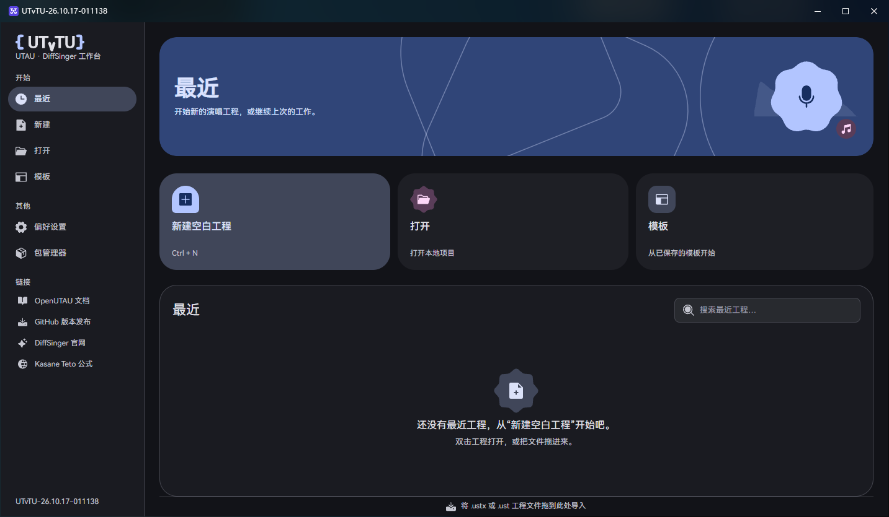
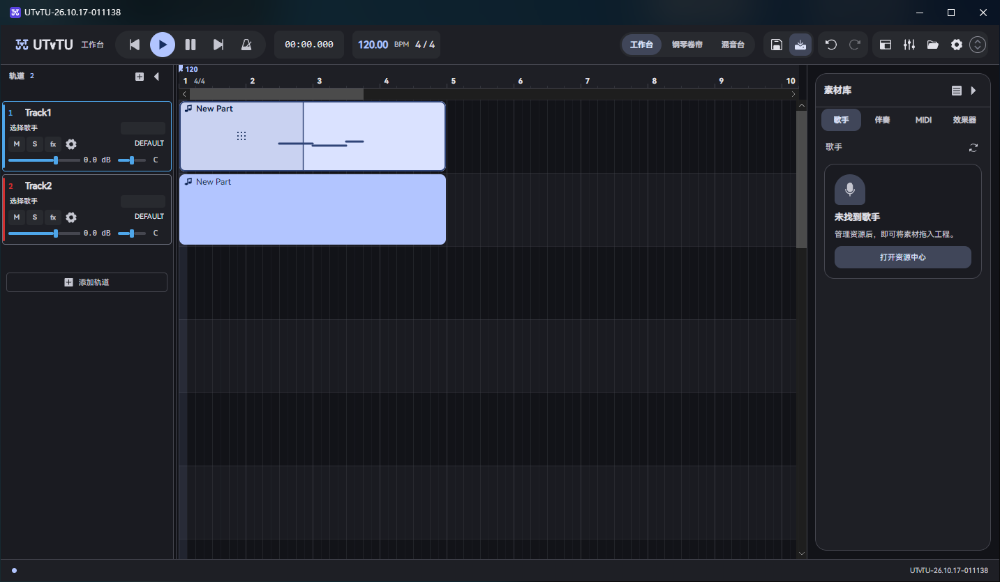
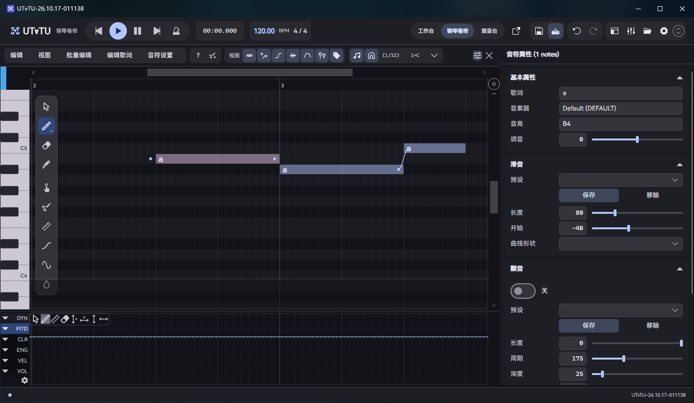
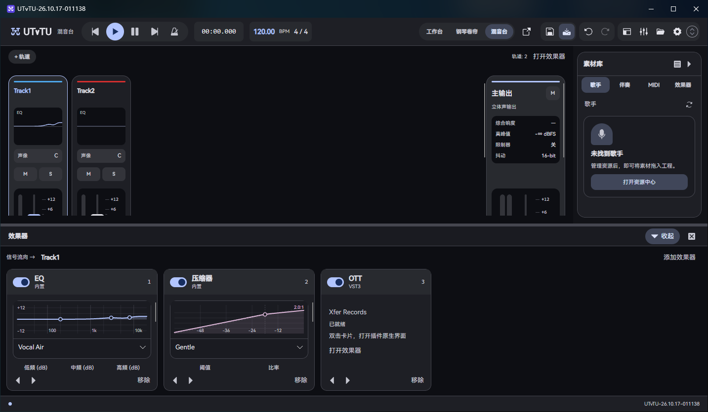
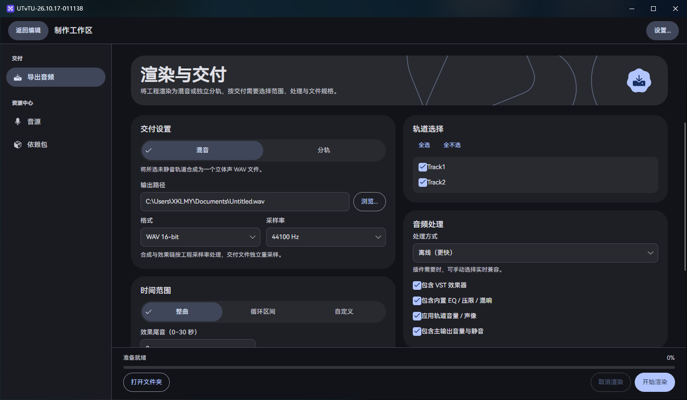
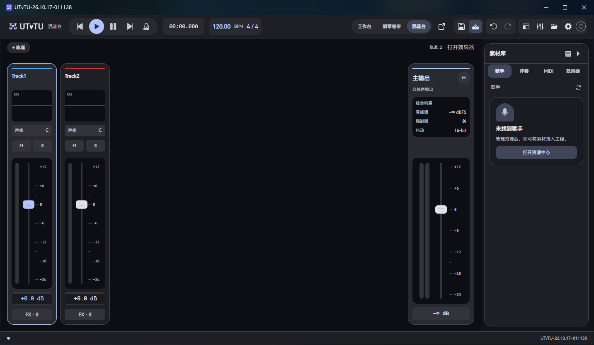
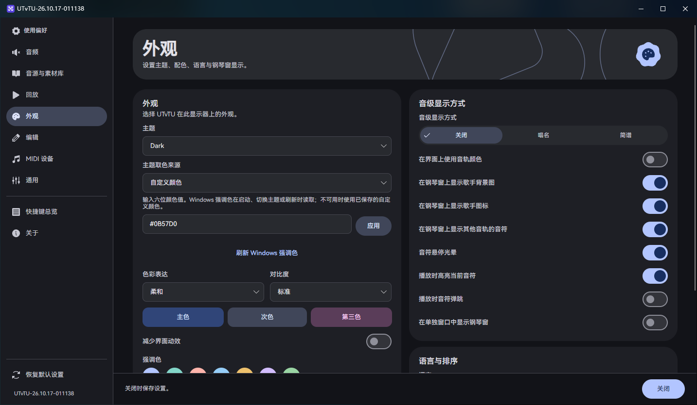
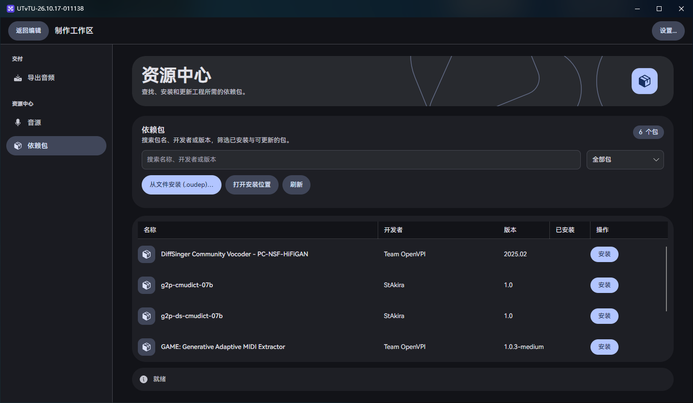

# UTvTU · 人声制作工作站

**从歌声编辑、合成到混音与音频交付，在一个工作区里完成。**

基于 [OpenUTAU](https://github.com/openutau/OpenUtau) 持续开发，当前面向 **Windows 10 / 11 x64**。由 [XKLMY](https://github.com/XKLMY-hi) 维护，原名 OpenUTAU Plus。

[下载发布版](https://github.com/XKLMY-hi/UTvTU/releases) · [反馈问题](https://github.com/XKLMY-hi/UTvTU/issues) · [English](README-en.md)

## 产品截图

<table>
  <tr>
    <td width="50%" align="center"><strong>多轨工作台</strong> </td>
    <td width="50%" align="center"><strong>钢琴卷帘</strong> </td>
  </tr>
  <tr>
    <td width="50%" align="center"><strong>混音台与效果器链</strong> </td>
    <td width="50%" align="center"><strong>渲染与交付</strong> </td>
  </tr>
</table>

更多界面：混音台、偏好设置与包管理器

**混音台**

**偏好设置**

**包管理器**

以上为 Windows 实机截图，版本 `UTvTU-26.10.17-011138`。点击主要展示区的图片可查看原图。

## 功能介绍

### 歌声编辑与合成

- 在钢琴卷帘中编辑音符、歌词、音高、滑音、颤音和表情曲线。
- 延续 OpenUTAU 的声库、音素化器及合成工作流，支持经典 UTAU 声库、第三方重采样器和 DiffSinger 等引擎。
- 在多轨编排中组织人声片段与伴奏，使用撤销 / 重做调整工程。
- 使用 `.ustxp` 保存 UTvTU 工程、效果器链和插件状态；兼容 `.ustx`，保留上游提供的 UST、MIDI、VSQx 等导入能力。

### 连贯的制作工作区

工作台、钢琴卷帘与混音台可在主窗口切换，钢琴卷帘和混音台也可分离使用。欢迎页提供新建、打开、最近工程和模板入口；资源中心、渲染页与偏好设置整合在主窗口中。小型编辑和确认操作使用内嵌浮层，支持键盘焦点、取消和减少动效。

### 统一效果器链与混音台

- 每轨提供音量推子、声像、静音、独奏与实时电平，另有主输出控制。
- **EQ、压缩器、混响是可独立添加的内置效果器**，支持重复实例、删除、旁通、排序和预设。
- 主编辑器与混音台共用底部横向效果器机架；从轨道的 FX 入口打开，在混音台中也可点击轨道条底部的 **FX · 数量**。
- **VST3 音频效果器使用名称卡片**，支持添加、替换、旁通、移除和重排；双击卡片打开插件原生 GUI。
- 原生插件窗口保持在 UTvTU 主窗口上方，并随主窗口最小化与恢复；不做全局置顶。
- 效果器链修改可撤销 / 重做；内置效果参数与 VST 状态随工程保存。

### 离线渲染与音频交付

默认使用离线导出，采用独立的导出插件实例处理音频。可选择立体声混音或独立分轨，设置整曲、循环区间或自定义范围，并保留所需的效果尾音。

| 交付设置 | 支持内容 |
|---|---|
| 文件格式 | WAV 16-bit、24-bit、32-bit float |
| 文件采样率 | 44.1 / 48 / 96 kHz |
| 处理选择 | VST、内置效果、轨道音量 / 声像、主输出设置 |
| 任务控制 | 进度、取消、完成后打开输出文件夹 |
| 插件兼容 | 可手动选择实时兼容模式 |

合成与效果链按工程内部采样率处理，输出文件可独立重采样；离线交付对所选轨道进行插件延迟对齐。第三方插件的实际兼容性取决于插件实现。

### Material Design 3 与 DAW 控件

- 基于 HCT / CAM16 的动态角色色，支持自定义种子色、Windows 强调色、深浅主题、配色方案和对比度设置。
- 共享按钮、输入、选择、旋钮、推子、菜单及浮层的视觉与状态反馈，保留音乐编辑需要的紧凑密度。
- 内嵌浮窗使用统一的主操作、次要操作、取消和关闭控件。
- 资源中心提供声库搜索、真实头像、OTO / 子音源信息及试听入口，并整合依赖包管理。

### 安装与使用

从 [Releases](https://github.com/XKLMY-hi/UTvTU/releases) 获取安装包，自带运行时，无需另装 .NET。当前安装链提供版本与文件清单校验、覆盖失败 / 取消回滚，以及默认保留用户数据的卸载方式。具体操作见[安装器说明](installer/README.md)，源码运行见[构建与开发](docs/BUILDING.md)。

本文介绍 `plus-develop` 的当前能力；下载包包含的功能以对应发布说明为准。新安装的数据目录仍使用 Windows“文档”下的 `OpenUtau Plus`，既有便携版保持原地数据模式。

当前重点是 Windows 人声制作流程。VST 乐器音源、Aux / 发送、侧链、轨道编组和完整播放延迟补偿尚未实现；离线导出的轨道延迟对齐已可用。

## 完整鸣谢

UTvTU 的工作建立在上游代码、开放标准、设计资源和社区经验之上。以下列出项目直接依赖与主要技术来源；具体版本、许可及补充声明见 [THIRD-PARTY-NOTICES.md](THIRD-PARTY-NOTICES.md)。

### 项目与贡献者

| 项目 / 贡献者 | 对本项目的贡献 |
|---|---|
| [OpenUTAU](https://github.com/openutau/OpenUtau)、[StAkira](https://github.com/stakira) 与[全部上游贡献者](https://github.com/openutau/OpenUtau/graphs/contributors) | 歌声编辑器、工程模型、合成与音素化框架，以及长期的维护与改进 |
| [UTAU](https://utau2008.xrea.jp/)、飴屋／菖蒲与 UTAU 社区 | 声库与重采样器生态、创作工具及使用经验 |
| [UTvTU 贡献者](https://github.com/XKLMY-hi/UTvTU/graphs/contributors)与历史 OpenUTAU Plus 贡献者 | 分支功能、界面、音频工作流、修复与文档 |
| [DiffSinger](https://github.com/MoonInTheRiver/DiffSinger) / [OpenVPI](https://github.com/openvpi) 与相关维护者 | 神经网络歌声合成及模型生态 |
| [CREPE](https://github.com/marl/crepe)、Jong Wook Kim 与贡献者 | 音高分析相关实现与资源 |
| 音素化器、词典、语言资源与翻译贡献者 | 多语言发音、工程兼容和本地化支持 |
| 提交反馈、测试工程和复现步骤的使用者 | 实际制作流程验证、兼容性反馈与交互改进 |

### 界面、音频与应用组件

| 项目 | 用途 |
|---|---|
| [Avalonia](https://github.com/AvaloniaUI/Avalonia)，含 Desktop、Fluent、DataGrid、ColorPicker 与 HarfBuzz 集成 | 桌面界面与基础控件 |
| [ReactiveUI](https://github.com/reactiveui/ReactiveUI)、[ReactiveUI.Avalonia](https://www.nuget.org/packages/ReactiveUI.Avalonia/14.7.1)、[Fody](https://github.com/Fody/Fody) / ReactiveUI.Fody、[Splat](https://github.com/reactiveui/splat)、[DynamicData](https://github.com/reactivemarbles/DynamicData)、[Reactive Extensions](https://github.com/dotnet/reactive) | 响应式 MVVM、集合与属性通知 |
| [SkiaSharp](https://github.com/mono/SkiaSharp)、[HarfBuzz](https://github.com/harfbuzz/harfbuzz) | 界面绘制与文字整形 |
| [.NET](https://github.com/dotnet/runtime) / System.* | 应用运行时、基础类库、JSON、编码和文件封装 |
| [NAudio](https://github.com/naudio/NAudio)、[NAudio.Vorbis](https://github.com/naudio/Vorbis)、[NAudio.Flac](https://github.com/BunLabs/NAudio.Flac)、[NLayer](https://github.com/naudio/NLayer)、[Concentus.OggFile](https://github.com/lostromb/concentus.oggfile) | 音频设备、处理与格式支持 |
| [NWaves](https://github.com/ar1st0crat/NWaves) | 音频信号处理与分析 |
| [ONNX Runtime](https://github.com/microsoft/onnxruntime) / DirectML | 合成模型推理 |
| [DryWetMidi](https://github.com/melanchall/drywetmidi) | MIDI 文件处理 |
| [YamlDotNet](https://github.com/aaubry/YamlDotNet)、[Newtonsoft.Json](https://github.com/JamesNK/Newtonsoft.Json) | 工程与配置序列化 |
| [Serilog](https://github.com/serilog/serilog) 及 Console / Debug / File sinks | 结构化日志 |
| [SharpCompress](https://github.com/adamhathcock/sharpcompress)、[Ignore](https://github.com/goelhardik/ignore) | 压缩包与忽略规则处理 |
| [csharp-kana](https://github.com/wolfgitpr/csharp-kana)、[csharp-pinyin](https://github.com/wolfgitpr/csharp-pinyin)、[WanaKana-net](https://github.com/MartinZikmund/WanaKana-net)、[UTF.Unknown](https://github.com/CharsetDetector/UTF-unknown) | 语言转换与编码检测 |
| [K4os.Hash.xxHash](https://github.com/MiloszKrajewski/K4os.Hash.xxHash)、[NumSharp](https://github.com/SciSharp/NumSharp)、[NeoLua](https://github.com/neolithos/neolua)、[NetMQ](https://github.com/zeromq/netmq)、[TextCopy](https://github.com/CopyText/TextCopy) | 哈希、数值、脚本、通信与剪贴板 |

### 原生音频与设计来源

| 项目 / 资源 | 用途 |
|---|---|
| [Steinberg VST3 SDK](https://github.com/steinbergmedia/vst3sdk) | VST3 音频效果器宿主与原生 GUI 桥接 |
| [Worldline](cpp/worldline)、[WORLD](https://github.com/mmorise/World)、[libgvps](https://github.com/Sleepwalking/libgvps)、[libpyin](https://github.com/Sleepwalking/libpyin) | 原生歌声合成与音频分析 |
| [miniaudio](https://github.com/mackron/miniaudio)、[libnpy](https://github.com/llohse/libnpy)、[spline](https://github.com/ttk592/spline)、[Abseil](https://github.com/abseil/abseil-cpp)、[xxHash](https://github.com/Cyan4973/xxHash) | 原生音频、数据读写与基础算法 |
| [Google Material Design](https://m3.material.io/)、[Material Color Utilities](https://github.com/material-foundation/material-color-utilities) | MD3 设计、HCT / CAM16 与动态颜色算法参考 |
| [AndroidX](https://github.com/androidx/androidx) 的 MaterialShapes、graphics-shapes 与状态令牌 | 几何图形、形变参数及交互状态参考 |
| [Phosphor Icons](https://github.com/phosphor-icons/core) | 界面图标 |
| 华为 [HarmonyOS Sans](https://developer.huawei.com/consumer/cn/design/resource/) | 应用字体；使用 [HarmonyOS Sans Fonts License Agreement](OpenUtau/Assets/Fonts/LICENSE.txt) |
| 声库、插件和截图中角色形象的创作者 | 各自的声音、工具与视觉作品；相关权利和使用条件归各权利人 |

感谢 [xUnit](https://github.com/xunit/xunit)、[Avalonia.Headless](https://github.com/AvaloniaUI/Avalonia)、[Microsoft Test Platform](https://github.com/microsoft/vstest)、[coverlet](https://github.com/coverlet-coverage/coverlet)、[GoogleTest](https://github.com/google/googletest)、[Bazel](https://github.com/bazelbuild/bazel)、[CMake](https://github.com/Kitware/CMake) 与 [GitHub Actions](https://github.com/features/actions) 提供的开发和验证工具。也感谢历史开发阶段使用过的 [SukiUI](https://github.com/kikipoulet/SukiUI) 与 [Dotnet.Bundle](https://github.com/egramtel/dotnet-bundle) 等项目。

主项目使用 [MIT 许可证](LICENSE.txt)，并保留上游版权声明。第三方代码、字体、声库、模型及插件分别遵循各自许可。

## Vibe coding 声明

UTvTU 使用 **vibe coding / AI 辅助开发**：由维护者提出产品目标、交互要求和使用反馈，借助 AI 工具参与方案讨论、代码编写、重构、调试与文档整理。

这一声明描述 UTvTU 的开发方式。OpenUTAU 的既有代码、第三方组件和社区资源继续保留原作者的署名与贡献，本项目在这些基础上扩展与重构。维护者负责项目方向、变更取舍和发布决策，功能描述以实际实现与验证结果为准。

欢迎通过 [Issues](https://github.com/XKLMY-hi/UTvTU/issues) 和 Pull Requests 提供复现、代码审阅与改进建议。

**By XKLMY · Built with vibe coding**

## 感谢 OpenUTAU 与 UTAU 社区

感谢 StAkira 与 OpenUTAU 的每一位贡献者。UTvTU 的歌声编辑、音素化、工程格式和合成能力都以你们长期积累的工作为基础；本项目会继续保留上游署名，并尊重原有设计与贡献。

感谢 UTAU 社区的声库作者、录音者、OTO 制作者、重采样器开发者、音素化器与词典维护者，以及翻译者、教程作者、调声师和音乐创作者。你们分享的声音、工具、知识和作品，让歌声合成成为可以共同参与、不断探索的创作方式。

希望 UTvTU 能在这些积累之上，让编辑、混音和交付更连贯，也让更多声音被听见。
